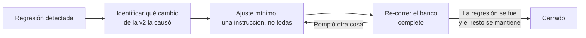

# Clase 17 · Taller de Prototipado (2) — Prueba de Regresión y Cierre del Prototipo v2

<div class="usm-session-meta">
<span>📅 Lunes 19 de octubre de 2026</span>
<span>⏱️ 90 minutos</span>
<span class="usm-tag-gold">Unidad 3 · Taller de Prototipado de Negocios con IA</span>
<span class="usm-tag-red">🚀 Hito 6C · 6% · se entrega en clases</span>
</div>

!!! warning "Sesión ajustada: el miércoles 14 de octubre no hubo clases"
    La [Clase 16](clase16.md) (prueba de regresión) no se dictó. Su contenido se trabaja **hoy**, junto
    con el cierre del prototipo, y el **Hito 6B se integra al 6C**: el Hito 6 queda en
    **6A (4%) + 6C (6%) = 10%**. La fecha del Hito 6 y de todo lo que viene después no cambia.

    Si alcanzan, lean antes la [Clase 16](clase16.md): explica el banco de casos y la tabla de
    comparación que se arman en la primera mitad del taller.

!!! danger "Entrega en clases: solo se evalúa lo enviado hoy entre 17:30 y 19:00"
    Hoy se cierra el **Hito 6** con su último avance: **Hito 6C — Comparación v1 vs. v2 y prototipo
    v2 cerrado (6%)**. Como el avance A ([Clase 15](clase15.md)), se trabaja y se envía **durante la
    sesión**, por el buzón.

    **Lo recibido fuera del horario de clases no se evalúa** y el avance queda con 0.

## 🎯 Objetivos de la sesión

- Construir una **prueba de regresión**: un banco fijo de casos que se ejecuta igual en cada versión.
- Comparar v1 y v2 sobre los mismos casos y detectar **regresiones**.
- Implementar y verificar **al menos una mitigación de riesgo** del Hito 5B en el prototipo.
- Documentar el cambio con la tabla **qué cambió / por qué / qué lo demuestra**.
- Dejar registrado lo que no se alcanzó a resolver, como insumo del Hito 7 y de la presentación final.

*Resultado de aprendizaje asociado: **CTS6 · RDA 3.2** — Implementa un dominio avanzado de
plataformas y programas, evaluando procedimientos y técnicas innovadoras.*

---

## 🗓️ Agenda (90 min)

| Tiempo | Bloque |
|---|---|
| 0:00 – 0:08 | Qué quedó del 6A y cómo se reorganiza el Hito 6 |
| 0:08 – 0:20 | Prueba de regresión: armar el banco de casos |
| 0:20 – 0:30 | Verificar una mitigación y resolver regresiones sin romper lo ganado |
| 0:30 – 1:15 | **Taller: banco → v1 → cambios → v2 → comparación → documentación** |
| 1:15 – 1:22 | Qué queda fuera del alcance: lo que no se resolvió |
| 1:22 – 1:28 | **Envío del Hito 6C** (buzón, antes de las 19:00) |
| 1:28 – 1:30 | Cierre y vínculo con la Clase 18 (evaluación social) |

---

## 📖 Contenidos

### 1. Por qué un prototipo de IA necesita prueba de regresión

Cuando corrigen un prompt, cambian el comportamiento del asistente **en todos los casos a la vez**.
Es habitual arreglar la alucinación y, sin notarlo, volver las respuestas tan cautas que el
prototipo deja de servir. Una **prueba de regresión** es la defensa: un conjunto fijo de casos que
se ejecuta igual antes y después de cada cambio. El detalle está en la [Clase 16](clase16.md).

Entre 6 y 8 casos, fijos y escritos textualmente:

| Tipo de caso | Cuántos | De dónde sale |
|---|---:|---|
| **Normales** | 3 | Uso esperado del prototipo |
| **Borde** | 2 | Dato faltante, cliente atípico, valor extremo |
| **Adversarios** | 1-2 | Intento de sacarlo de su tarea, pregunta fuera de alcance |
| **De riesgo** | 1-2 | El caso del sesgo o la privacidad del Hito 5 (ej. la prueba del par) |

> ⚠️ Los casos se escriben **una vez** y no se cambian entre versiones. Si cambian la pregunta, la
> comparación deja de significar algo.

La **tabla de comparación** pone ambos resultados lado a lado:

| # | Caso (entrada textual) | Resultado v1 | Resultado v2 | Veredicto |
|---:|---|---|---|---|
| 2 | Cliente sin historial | Inventó un puntaje | "Sin datos suficientes" | ✅ Mejora |
| 4 | Caso del par (comuna A vs. B) | Recomendaciones distintas | Iguales | ✅ Mitigación efectiva |
| 5 | Caso normal con dato parcial | Respondía con supuestos | Ahora pide el dato faltante | ⚠️ Revisar: ¿quedó demasiado estricto? |

La fila 5 es el hallazgo más valioso: una corrección que se pasó de cautelosa. El Hito 6 valora que
lo detecten y lo digan, no que todas las filas digan "mejora".

### 2. Una mitigación no está implementada hasta que se verifica

En el Hito 5B escribieron mitigaciones. En el 6A las empezaron a aplicar. Hoy hay que cerrar el
círculo, y el círculo tiene tres partes:

| Paso | Pregunta | Evidencia |
|---|---|---|
| **Implementar** | ¿Qué cambió exactamente en el prototipo? | El texto del cambio (instrucción, campo eliminado, paso agregado) |
| **Verificar** | ¿El caso de riesgo del banco se comporta distinto ahora? | La salida antes y la salida después |
| **Acotar** | ¿En qué situaciones la mitigación **no** funciona? | Una frase honesta |

> 💡 El tercer paso es el que distingue un trabajo maduro. Toda mitigación tiene un límite; decir
> cuál es vale más que afirmar que el problema está resuelto.

### 3. Resolver regresiones sin deshacer lo ganado

Si en la comparación apareció una fila "⚠️ revisar", se resuelve antes de entregar:



La regla operativa: **un cambio a la vez, y volver a correr el banco completo después de cada uno**.
Si cambian tres cosas y el resultado empeora, no sabrán cuál fue.

Tres compensaciones habituales al endurecer un prototipo:

| Al corregir… | Suele aparecer… | Cómo equilibrar |
|---|---|---|
| Alucinaciones (exigir fuentes) | Responde "no tengo ese dato" demasiado seguido | Permitir responder con lo que sí hay, marcando lo que falta |
| Salidas fuera de alcance (límites duros) | Rechaza preguntas legítimas vecinas | Listar ejemplos de lo que **sí** está dentro del alcance |
| Sesgo (quitar variables) | Pierde capacidad de recomendar bien | Mantener la variable y controlar el resultado, en vez de ocultarla |

### 4. La tabla de documentación del cambio

Una fila por cambio:

| Qué cambió | Por qué | Qué lo demuestra |
|---|---|---|
| Se agregó la regla "sin datos suficientes" al bloque PASOS | El prototipo inventaba un puntaje para clientes sin historial (bitácora, caso 2) | Caso 2 del banco: antes puntaje inventado, ahora la frase exacta |
| Se eliminó la comuna del archivo de entrada | Actuaba como proxy socioeconómico (Hito 5A) | Prueba del par: antes recomendaciones distintas, ahora iguales |
| Se listaron ejemplos de preguntas dentro del alcance | El endurecimiento rechazaba consultas legítimas | Caso 5: antes rechazada, ahora respondida |

### 5. Lo que no se resolvió también se entrega

Dejen escrito, en dos o tres líneas, qué quedó pendiente y por qué: falta de datos reales, límite de
la herramienta, necesidad de integración con un sistema, o tiempo. No resta puntaje — es la materia
prima de la sección de limitaciones del **Hito 7** y de la presentación final.

---

## ✏️ Taller y entrega del Hito 6C

*Esto **sí** se entrega hoy, antes de las 19:00. Vale el 6% de la nota final.*

En su grupo de proyecto, en este orden (si el tiempo no alcanza, lo primero es lo que más pesa):

1. **Escriban el banco de casos** (6-8), con la mezcla de la sección 1, incluido el caso de riesgo.
2. **Córranlo en el prototipo actual** y guarden los resultados como "v1". Si ya implementaron el
   cambio del 6A, usen las capturas del "antes" que guardaron ese día.
3. **Implementen la mitigación** elegida del Hito 5B y las mejoras pendientes del backlog.
4. **Vuelvan a correr los mismos casos** como "v2" y completen la **tabla de comparación**.
5. **Resuelvan las regresiones**, un cambio a la vez, re-corriendo el banco después de cada uno.
6. **Completen la tabla** qué cambió / por qué / qué lo demuestra, y guarden la **configuración
   final** del prototipo (instrucciones completas, copiadas y pegadas).
7. **Escriban lo pendiente**: dos o tres líneas sobre lo que no alcanzaron a resolver.

### 📤 Cómo entregar el Hito 6C

- [ ] El **banco de casos** (6-8 entradas, escritas textualmente).
- [ ] La **tabla de comparación** v1 vs. v2, con el veredicto de cada fila y al menos una
      **regresión o compensación** señalada (o cómo verificaron que no hay).
- [ ] La **tabla de documentación del cambio**, con al menos una **mitigación verificada** con el
      caso de riesgo: antes y después.
- [ ] Configuración final del prototipo (texto completo de las instrucciones).
- [ ] Párrafo de lo que quedó pendiente.
- [ ] Máximo cuatro páginas; se aceptan capturas.
- [ ] Subido al **buzón del Hito 6C** (abajo), con el **nombre del grupo** escrito igual
      que en la planilla del curso.
- [ ] **Enviado entre las 17:30 y las 19:00 de hoy.** Fuera de ese horario no se evalúa.

> ⚠️ Si no alcanzaron a correr los 8 casos, envíen los que sí tienen. Una comparación parcial
> entregada a tiempo se evalúa; una completa enviada mañana, no.

> 📌 Con este envío queda cerrado el **Hito 6** (6A + 6C = 10%). El prototipo ya no se modifica para
> efectos de evaluación: lo que viene es evaluarlo como proyecto de negocio.

!!! tip "Usen el asistente para esto también"
    ```text
    Estas son las instrucciones de la versión 1 de mi asistente y estas las de la versión 2.
    Estos son los resultados de los mismos 7 casos en cada versión.
    1. Dime en qué casos mejoró, en cuáles no cambió y en cuáles empeoró.
    2. Señala si algún cambio de la v2 pudo causar el empeoramiento, y cuál.
    3. Propón el ajuste mínimo para corregirlo sin perder lo que ya mejoró.
    ```
    Después verifiquen ustedes: el asistente no es juez de su propio trabajo.

---

## 📚 Para la próxima clase

- La [Clase 18](clase18.md) (miércoles 21 de octubre) abre la última unidad: **Evaluación Social de Iniciativas
  basadas en IA**, y con ella empieza el **Hito 7**, que también se construye en avances entregados
  en clases: 7A (21 oct), 7B (26 oct), 7C (28 oct) y 7D (2 nov).
- Traigan el párrafo de pendientes de hoy: varias de esas limitaciones son costos o supuestos que
  aparecerán en la evaluación de viabilidad.

---

## 📬 Buzón del Hito 6C

<div class="usm-cta" markdown>
<div class="usm-cta-text">
<strong>📤 Entrega aquí el Hito 6C — Comparación v1 vs. v2 y prototipo v2 cerrado</strong>
<span>Un <strong>PDF por grupo</strong>, con el nombre del grupo. El buzón <strong>se cierra a las 19:20</strong>, pero solo se evalúa lo enviado <strong>hasta las 19:00</strong>.</span>
</div>
[📬 Abrir buzón](https://script.google.com/macros/s/AKfycbz7ZR7YRvRjDcpEgcjCeIcI8qzfBShLpPoxmYisZS4t8GeEDbEvAp9lg1sIrZKBiLyQ7A/exec?a=hito6c){.usm-btn target="_blank" rel="noopener"}
</div>

Ver todos los buzones y las reglas de entrega en [Entregas](../entregas.md).
