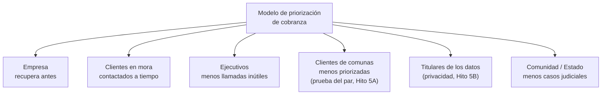
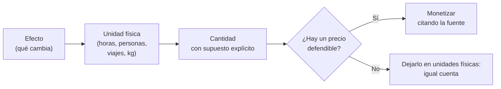

# Clase 18 · Evaluación Social de Iniciativas basadas en IA

<div class="usm-session-meta">
<span>📅 Miércoles 21 de octubre de 2026</span>
<span>⏱️ 90 minutos</span>
<span class="usm-tag-gold">Unidad 3 · Diseño de una Solución con IA: Evaluación Social y Privada</span>
<span class="usm-tag-red">🚀 Hito 7A · 2,5% · se entrega en clases</span>
</div>

!!! danger "Entrega en clases: solo se evalúa lo enviado hoy entre 17:30 y 19:00"
    Hoy empieza el [Hito 7 — Evaluación de viabilidad](../proyecto.md#hito-7-evaluacion-de-viabilidad),
    que se construye en **cuatro avances entregados en clases** (2,5% cada uno): **7A hoy**, 7B el
    26 de octubre, 7C el 28 de octubre y 7D el 2 de noviembre.

    Hoy corresponde el **Hito 7A — Impacto social**. Se sube al buzón **durante la sesión**; lo
    recibido fuera del horario de clases no se evalúa y el avance queda con 0.

## 🎯 Objetivos de la sesión

- Distinguir la **evaluación privada** (¿le conviene a la empresa?) de la **evaluación social**
  (¿la sociedad queda mejor?) de una misma iniciativa con IA.
- Identificar a **quiénes afecta** la solución más allá de la empresa, para bien y para mal.
- Medir los efectos en **unidades físicas** antes de intentar ponerles precio.
- Reconocer las **transferencias**: lo que una parte gana porque otra lo pierde no es beneficio social.
- Producir el mapa de actores y la tabla de efectos del Hito 7A.

*Resultado de aprendizaje asociado: **CTS6 · RDA 3.2** — Implementa un dominio avanzado de
plataformas y programas, evaluando procedimientos y técnicas innovadoras.*

---

## 🗓️ Agenda (90 min)

| Tiempo | Bloque |
|---|---|
| 0:00 – 0:10 | Cierre del Hito 6 y qué pide el Hito 7: cuatro avances, una conclusión |
| 0:10 – 0:25 | Privada vs. social: el mismo proyecto, dos preguntas distintas |
| 0:25 – 0:40 | Quiénes ganan y quiénes pierden: el mapa de actores de una solución con IA |
| 0:40 – 0:50 | Medir antes de monetizar · la trampa de las transferencias |
| 0:50 – 1:20 | **Taller: mapa de actores y tabla de efectos (Hito 7A)** |
| 1:20 – 1:28 | **Envío del Hito 7A** (buzón, antes de las 19:00) |
| 1:28 – 1:30 | Cierre y vínculo con la Clase 19 (evaluación privada) |

---

## 📖 Contenidos

### 1. El mismo proyecto, dos preguntas

Ya conocen la evaluación de proyectos desde los cursos de la carrera. Lo que cambia aquí es el
objeto: una solución con IA tiene efectos que **no pasan por el flujo de caja de la empresa**, y
algunos de ellos son justamente los riesgos que analizaron en el Hito 5.

| | Evaluación privada | Evaluación social |
|---|---|---|
| **Pregunta** | ¿Le conviene a la empresa? | ¿La sociedad queda mejor con el proyecto que sin él? |
| **Punto de vista** | El dueño o inversionista | El conjunto de personas afectadas |
| **Precios** | De mercado | Sociales (costo de oportunidad real de los recursos) |
| **Impuestos y subsidios** | Costo o ingreso | **Transferencia**: no cuentan |
| **Externalidades** | No aparecen | Se incluyen, aunque nadie las pague |
| **En el curso** | Avances 7B, 7C y 7D | **Avance 7A (hoy)** |

> 💡 Los dos resultados pueden apuntar en direcciones distintas, y esa diferencia es información de
> negocio. Un proyecto con buen resultado privado y costo social alto suele terminar enfrentando
> reclamos, regulación o daño reputacional: pierde su **licencia social para operar**.

### 2. Quiénes ganan y quiénes pierden

Sigamos con el ejemplo que venimos usando desde la Clase 13: un modelo que le dice a un equipo de
cobranza **a qué clientes en mora llamar primero**.



Cuatro preguntas para armar el mapa de su propio proyecto:

1. **¿Quién usa la solución?** (el usuario interno o el cliente final)
2. **¿Sobre quién decide o recomienda?** (a menudo, alguien que nunca ve el sistema)
3. **¿Qué trabajo cambia?** (tareas que se eliminan, se reasignan o aparecen)
4. **¿Quién queda fuera o es tratado distinto?** (aquí entra directo su auditoría de sesgo)

Efectos sociales frecuentes en iniciativas con IA:

| Efecto | Signo habitual | Ejemplo |
|---|---|---|
| Tiempo ahorrado | ➕ | Menos horas de espera, de traslado o de trabajo repetitivo |
| Riesgo evitado | ➕ | Fallas, accidentes o quiebres de stock que no ocurren |
| Recursos no desperdiciados | ➕ | Menos merma, menos viajes, menos energía |
| Acceso ampliado | ➕ | Un servicio que llega a quienes antes no atendía |
| Exclusión o trato desigual | ➖ | El sesgo detectado en el Hito 5A |
| Exposición de datos personales | ➖ | El riesgo de privacidad del Hito 5B |
| Cambio en el empleo | ➕ / ➖ | Depende de si las horas liberadas se reasignan o se recortan |
| Dependencia de un proveedor | ➖ | Si el proveedor cambia precio o condiciones, el servicio se cae |

### 3. Medir antes de monetizar

El error más común es saltar directo a los pesos y terminar con una cifra que nadie puede defender.
El orden correcto:



En el ejemplo: *"3 ejecutivos dejan de hacer unas 40 llamadas inútiles al día cada uno; a 3
minutos por llamada son unas 6 horas diarias liberadas (supuesto ilustrativo)."* Eso ya es
evidencia, aunque todavía no tenga precio.

> 📌 Para valorar el tiempo en una evaluación social en Chile, la referencia son los **precios
> sociales** que publica el Ministerio de Desarrollo Social y Familia para el Sistema Nacional de
> Inversiones. Si los usan, citen la fuente y el año. Si un efecto no tiene un precio defendible,
> déjenlo en unidades físicas: es mejor que inventar una cifra.

### 4. La trampa de las transferencias

Lo que una parte gana **porque otra lo pierde** no es beneficio social: es plata que cambia de
bolsillo.

| Efecto | ¿Beneficio social? | Por qué |
|---|---|---|
| La empresa recupera más deuda | ❌ Transferencia | Lo que la empresa gana, el cliente lo paga |
| El cliente evita intereses y costos judiciales | ✅ En parte | Los costos judiciales consumen recursos reales (tiempo de tribunales, abogados) |
| La empresa paga menos impuesto por un crédito tributario | ❌ Transferencia | Lo que la empresa ahorra, el Estado lo deja de recibir |
| Las horas liberadas se usan en otra tarea productiva | ✅ | El recurso queda disponible para producir otra cosa |
| Las horas liberadas se traducen en despidos | ⚠️ Depende | Sin reubicación, hay un costo social de transición que no se puede omitir |

> ⚠️ **Para el proyecto:** si su mayor "beneficio social" es que la empresa gana más, revisen la
> tabla. Probablemente es un beneficio privado, y va en el 7B.

---

## ✏️ Taller y entrega del Hito 7A

*Esto **sí** se entrega hoy, antes de las 19:00. Vale el 2,5% de la nota final.*

En su grupo de proyecto:

**A. Mapa de actores.** Al menos **cuatro actores**, de los cuales tres están **fuera de la
empresa**. Pueden dibujarlo a mano y sacarle una foto.

**B. Tabla de efectos sociales**

| # | Efecto | ¿A quién afecta? | Signo (➕/➖) | Unidad física | Cantidad aproximada y supuesto | ¿Se puede monetizar? |
|---:|---|---|:---:|---|---|---|
| 1 | | | | | | |
| 2 | | | | | | |
| 3 | | | | | | |
| 4 | | | | | | |
| 5 | | | | | | |

**C. Transferencias.** Al menos **una** cosa que parece beneficio pero es transferencia, y por qué
la dejan fuera.

**D. Conclusión en tres líneas**

> *"Con el proyecto, la sociedad queda __________ porque __________. El costo lo pagan
> principalmente __________, y lo mitigamos con __________."*

### 📤 Cómo entregar el Hito 7A

- [ ] Mapa de actores con al menos tres actores fuera de la empresa.
- [ ] Tabla de efectos con al menos **tres beneficios** y **dos costos o perjudicados**, cada uno en
      su unidad física.
- [ ] Al menos un efecto **cuantificado** con su supuesto explícito.
- [ ] Al menos un efecto negativo conectado a un riesgo del **Hito 5**, con su mitigación.
- [ ] Una transferencia identificada y excluida.
- [ ] Conclusión de tres líneas.
- [ ] Máximo dos páginas; se aceptan fotos del mapa.
- [ ] Subido al **buzón del Hito 7A** (abajo), con el **nombre del grupo** escrito igual que en la
      planilla del curso.
- [ ] **Enviado entre las 17:30 y las 19:00 de hoy.** Fuera de ese horario no se evalúa.

> ⚠️ Las cantidades de hoy (usuarios, horas, transacciones) son la base de los avances 7B, 7C y 7D:
> el criterio de evaluación del Hito 7 incluye la **trazabilidad** entre avances. Escriban los
> supuestos de forma que puedan reutilizarlos el lunes.

!!! tip "Usen el asistente para ampliar el mapa, no para cerrarlo"
    ```text
    Mi proyecto es [descripción en dos líneas]. La solución con IA hace [qué hace] y la usa [quién].
    1. Lista los actores fuera de la empresa que se ven afectados, positiva o negativamente.
    2. Para cada uno, propone un efecto y una unidad física para medirlo.
    3. Señala cuáles de esos efectos son en realidad transferencias.
    ```
    Después descarten lo genérico y quédense con lo que pueden sostener con un supuesto. Un mapa
    con cuatro actores bien justificados vale más que uno con doce de relleno.

---

## 📚 Para la próxima clase

- La Clase 19 (lunes 26 de octubre) toma el mismo proyecto desde la empresa: **Evaluación Privada**.
  Ahí se entrega el **Hito 7B**: cuántos usuarios o transacciones alcanza la solución, quién captura
  el valor y a través de qué mecanismo.
- Traigan la tabla de hoy: los beneficios que descartaron como transferencias suelen ser exactamente
  los que aparecen en la evaluación privada.

---

## 📬 Buzón del Hito 7A

<div class="usm-cta" markdown>
<div class="usm-cta-text">
<strong>📤 Entrega aquí el Hito 7A — Impacto social</strong>
<span>Un <strong>PDF por grupo</strong>, con el nombre del grupo. El buzón <strong>se cierra a las 19:20</strong>, pero solo se evalúa lo enviado <strong>hasta las 19:00</strong>.</span>
</div>
[📬 Abrir buzón](https://script.google.com/macros/s/AKfycbz7ZR7YRvRjDcpEgcjCeIcI8qzfBShLpPoxmYisZS4t8GeEDbEvAp9lg1sIrZKBiLyQ7A/exec?a=hito7a){.usm-btn target="_blank" rel="noopener"}
</div>

Ver todos los buzones y las reglas de entrega en [Entregas](../entregas.md).
