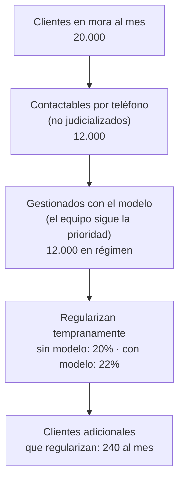

# Clase 19 · Evaluación Privada de Iniciativas basadas en IA

<div class="usm-session-meta">
<span>📅 Lunes 26 de octubre de 2026</span>
<span>⏱️ 90 minutos</span>
<span class="usm-tag-gold">Unidad 3 · Diseño de una Solución con IA: Evaluación Social y Privada</span>
<span class="usm-tag-red">🚀 Hito 7B · 2,5% · se entrega en clases</span>
</div>

!!! danger "Entrega en clases: solo se evalúa lo enviado hoy entre 17:30 y 19:00"
    Segundo avance del [Hito 7](../proyecto.md#hito-7-evaluacion-de-viabilidad): **Hito 7B —
    Evaluación privada (2,5%)**. Se trabaja y se sube al buzón **durante la sesión**; lo recibido
    fuera del horario de clases no se evalúa y el avance queda con 0.

    Lo que armen hoy (la **hoja de supuestos**) se reutiliza en el 7C y el 7D: el Hito 7 evalúa la
    **trazabilidad** entre avances.

## 🎯 Objetivos de la sesión

- Pasar del punto de vista de la sociedad (7A) al de **quien invierte** en la solución.
- Estimar el **alcance** de la solución con un embudo: de la población total al uso efectivo.
- Identificar **quién captura el valor** y **a través de qué mecanismo**.
- Medir el valor **contra la situación sin proyecto**, no contra cero.
- Abrir la **hoja de supuestos** del proyecto, que se usará en los avances 7C y 7D.

*Resultado de aprendizaje asociado: **CTS6 · RDA 3.2** — Implementa un dominio avanzado de
plataformas y programas, evaluando procedimientos y técnicas innovadoras.*

---

## 🗓️ Agenda (90 min)

| Tiempo | Bloque |
|---|---|
| 0:00 – 0:10 | Qué mostraron los 7A: transferencias bien y mal identificadas |
| 0:10 – 0:20 | De la sociedad a la empresa: qué cambia en la mirada privada |
| 0:20 – 0:35 | El embudo de alcance: cuántos usuarios o transacciones, de verdad |
| 0:35 – 0:50 | Quién captura el valor y cómo · la situación sin proyecto |
| 0:50 – 1:20 | **Taller: embudo, captura de valor y hoja de supuestos (Hito 7B)** |
| 1:20 – 1:28 | **Envío del Hito 7B** (buzón, antes de las 19:00) |
| 1:28 – 1:30 | Cierre y vínculo con la Clase 20 (costos) |

---

## 📖 Contenidos

### 1. De la sociedad a la empresa

En la [Clase 18](clase18.md) dejaron fuera lo que una parte gana porque otra lo pierde. En la
evaluación privada **eso vuelve a contar**, porque ahora la pregunta es si le conviene a quien pone
la plata.

| | En el 7A (social) | En el 7B (privada) |
|---|---|---|
| La empresa recupera más deuda | Transferencia: no cuenta | ✅ Beneficio |
| Impuestos | Transferencia: no cuentan | Cuentan (pueden trabajar antes de impuestos si lo declaran) |
| El cliente evita intereses | ✅ Beneficio | No es de la empresa: no cuenta |
| Precios | Sociales | De mercado |

### 2. El embudo de alcance

El número de usuarios "potenciales" casi nunca es el número que genera valor. Sigamos con el ejemplo
de cobranza de las clases anteriores (todas las cifras son **ilustrativas**):



Cada paso del embudo es un **supuesto**, y cada supuesto necesita una fuente o una razón:

- **Población total:** ¿de dónde sale? (reporte interno, dato público, estimación por analogía)
- **Elegibles:** ¿qué filtro dejan fuera a una parte? (sin teléfono, otro canal, otra región)
- **Adopción:** ¿qué fracción usa realmente la herramienta? Casi nunca es 100% el primer mes.
- **Efecto:** ¿cuánto cambia el resultado por usuario? Este suele ser el supuesto más débil.

> ⚠️ **Adopción no es instalación.** Que la herramienta esté disponible para 15 ejecutivos no
> significa que 15 la usen. Si su proyecto depende de que las personas cambien cómo trabajan,
> pongan una rampa (por ejemplo, 30% → 60% → 100% en tres meses) y justifíquenla.

### 3. Quién captura el valor, y cómo

| Mecanismo | Cómo se calcula | Ejemplo |
|---|---|---|
| **Costo evitado** | Unidades evitadas × costo unitario | Horas de llamadas inútiles, redespachos, mantenciones correctivas |
| **Ingreso adicional** | Unidades adicionales × **margen** (no precio) | Ventas que no se pierden por quiebre de stock |
| **Pérdida evitada** | Probabilidad × impacto, antes y después | Deuda que no se castiga, fallas que no ocurren |
| **Capital liberado** | Inventario o caja que deja de estar inmovilizado | Menos stock de seguridad |

Y para quién:

- **Solución interna** (la empresa la usa para sí misma): el valor lo captura la empresa, vía
  costos o ingresos.
- **Solución como producto** (se vende a otras empresas): el valor se reparte entre el cliente y
  ustedes. Hay que decir **cómo se cobra**: suscripción, pago por uso o porcentaje del ahorro.

> 💡 Si su proyecto es un producto, la pregunta clave es **qué fracción del valor que genera al
> cliente pueden cobrar** sin que deje de convenirle. Rara vez es más de un tercio.

### 4. Contra la situación sin proyecto, no contra cero

El valor de la solución es la **diferencia** entre lo que pasa con ella y lo que pasaría sin ella.
En el ejemplo, sin modelo el 20% de los contactados ya regulariza: el modelo no "recupera" a todos,
solo a los **2 puntos adicionales**.

| | Sin proyecto | Con proyecto | Incremental |
|---|---:|---:|---:|
| Contactados al mes | 12.000 | 12.000 | 0 |
| Tasa de regularización temprana | 20% | 22% | +2 pts |
| Clientes que regularizan | 2.400 | 2.640 | **+240** |
| Deuda promedio | $120.000 | $120.000 | — |
| Fracción que sin regularizar se habría perdido | 40% | 40% | — |
| **Pérdida evitada al mes** | | | **≈ $11,5 MM** |

*(240 clientes × $120.000 × 40% = $11.520.000 al mes, en régimen.)*

### 5. La hoja de supuestos

Es una tabla viva: la abren hoy, la amplían en el 7C con los costos y la usan completa en el 7D.

| # | Supuesto | Valor | Fuente o razón | Se usa en |
|---:|---|---|---|---|
| S1 | Clientes contactables al mes | 12.000 | Reporte de cartera (ilustrativo) | 7B, 7C, 7D |
| S2 | Tasa de regularización sin modelo | 20% | Histórico del área | 7B, 7D |
| S3 | Mejora de la tasa con el modelo | +2 pts | Resultado del banco de casos + supuesto conservador | 7B, 7D |
| S4 | Deuda promedio | $120.000 | Reporte de cartera | 7B, 7D |
| S5 | Fracción que se habría perdido | 40% | Tasa histórica de castigo | 7B, 7D |
| S6 | Rampa de adopción | 30% / 60% / 100% | Experiencia de otros cambios de herramienta | 7D |

> 📌 Marquen con ⚠️ el supuesto del que dependen más y del que tienen menos evidencia. En el ejemplo
> es S3. En el 7D van a calcular **qué valor de ese supuesto hace que el proyecto deje de ser viable**.

---

## ✏️ Taller y entrega del Hito 7B

*Esto **sí** se entrega hoy, antes de las 19:00. Vale el 2,5% de la nota final.*

En su grupo de proyecto:

1. **Dibujen el embudo de alcance** de su solución, con un número y un supuesto en cada paso.
2. **Describan la situación sin proyecto** en dos o tres líneas: qué pasa hoy y con qué resultado.
3. **Completen la tabla de captura de valor**: mecanismo, quién lo captura y cuánto al mes (en
   régimen), calculado como **incremental** sobre la situación sin proyecto.
4. Si su solución es un **producto**, digan cómo se cobra y qué fracción del valor capturan ustedes.
5. **Abran la hoja de supuestos** con al menos cinco supuestos, y marquen el más crítico.

### 📤 Cómo entregar el Hito 7B

- [ ] Embudo de alcance con números y un supuesto por paso.
- [ ] Situación sin proyecto descrita.
- [ ] Tabla de captura de valor, con el cálculo incremental a la vista.
- [ ] Hoja de supuestos con **al menos cinco supuestos**, cada uno con su fuente o razón, y el
      supuesto crítico marcado.
- [ ] Coherencia con el 7A: lo que allí excluyeron como transferencia puede aparecer aquí.
- [ ] Máximo dos páginas; se aceptan capturas de planilla.
- [ ] Subido al **buzón del Hito 7B** (abajo), con el **nombre del grupo** escrito igual que en la
      planilla del curso.
- [ ] **Enviado entre las 17:30 y las 19:00 de hoy.** Fuera de ese horario no se evalúa.

!!! tip "Usen el asistente para atacar sus supuestos"
    ```text
    Esta es la hoja de supuestos de mi proyecto: [pegar tabla].
    1. ¿Cuál de estos supuestos te parece más optimista y por qué?
    2. ¿Qué dato público o interno permitiría verificar cada uno?
    3. ¿Falta algún paso en el embudo entre la población total y el uso efectivo?
    ```
    El asistente no conoce su empresa: úsenlo para encontrar preguntas, no para inventar cifras.

---

## 📚 Para la próxima clase

- La [Clase 20](clase20.md) (miércoles 28 de octubre) es el taller de **costos de operar la
  solución**, y ahí se entrega el **Hito 7C**.
- Traigan la hoja de supuestos en formato editable (planilla): los costos se agregan a la misma hoja.
- Revisen el prototipo del Hito 6: qué herramientas usa, cuántas consultas hace y quién lo supervisa.
  Todo eso cuesta.

---

## 📬 Buzón del Hito 7B

<div class="usm-cta" markdown>
<div class="usm-cta-text">
<strong>📤 Entrega aquí el Hito 7B — Evaluación privada</strong>
<span>Un <strong>PDF por grupo</strong>, con el nombre del grupo. El buzón <strong>se cierra a las 19:20</strong>, pero solo se evalúa lo enviado <strong>hasta las 19:00</strong>.</span>
</div>
[📬 Abrir buzón](https://script.google.com/macros/s/AKfycbz7ZR7YRvRjDcpEgcjCeIcI8qzfBShLpPoxmYisZS4t8GeEDbEvAp9lg1sIrZKBiLyQ7A/exec?a=hito7b){.usm-btn target="_blank" rel="noopener"}
</div>

Ver todos los buzones y las reglas de entrega en [Entregas](../entregas.md).
