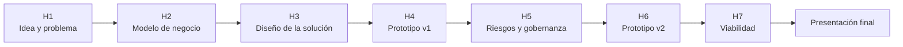

# Clase 23 · Presentaciones Finales (2) y Cierre del Curso

📅 Lunes 16 de noviembre de 2026
⏱️ 90 minutos · 🏫 presencial
Presentación Final del Proyecto
🎤 Presentación Final · 30% · pares 10% + profesor 10% + prototipo 10%

!!! info "Segunda jornada de presentaciones y última clase del semestre"
    Presentan los **cinco grupos** que faltan, en el orden sorteado (abajo), con las mismas
    [reglas y pautas](clase22.md#reglas-de-las-dos-jornadas) del lunes 9. Después se cierra el
    curso.

## 🎤 Orden de hoy

| Orden | Grupo |
|---:|---|
| 1 | Lanyardigans |
| 2 | Starcompany |
| 3 | energIA |
| 4 | los_capi |
| 5 | six_pack |

*Sorteado el 21 de octubre; ver la [Clase 22](clase22.md#orden-de-presentacion).*

## 🗓️ Agenda (90 min)

| Tiempo | Bloque |
|---|---|
| 0:00 – 0:05 | Instrucciones y orden |
| 0:05 – 1:15 | **Cinco presentaciones** de 14 minutos: 8 de pitch + 4 de preguntas + 2 para que los grupos evalúen |
| 1:15 – 1:28 | Cierre del curso: retroalimentación general y evaluación del curso |
| 1:28 – 1:30 | Cierre |

<strong>🗳️ Evaluación de pares</strong>
Abierta hoy de <strong>17:00 a 20:00</strong>. En «Código del día» escriban <strong>ICS64225</strong>.

[🗳️ Abrir formulario](https://script.google.com/macros/s/AKfycbz7ZR7YRvRjDcpEgcjCeIcI8qzfBShLpPoxmYisZS4t8GeEDbEvAp9lg1sIrZKBiLyQ7A/exec?pares){.usm-btn target="_blank" rel="noopener"}

> 💡 Los grupos que ya presentaron ahora son el comité. Ya saben qué preguntas cuesta responder:
> háganlas.

---

## 🏁 Cierre del curso

### El recorrido del semestre

### Lo que se llevan

| Habilidad | Dónde la practicaron |
|---|---|
| Distinguir cuándo un problema es de ML predictivo, de IA generativa o de ninguno | Hitos 1 y 3 |
| Prototipar sin programar y demostrar que funciona con casos fijos | Hitos 4 y 6 |
| Detectar sesgo y riesgo de privacidad antes de que lo detecte otro | Hito 5 |
| Ponerle números a una iniciativa y decir qué supuesto la decide | Hito 7 |
| Convencer a un comité con evidencia, en ocho minutos | Presentación final |

> 💡 Las herramientas que usaron este semestre van a cambiar. La pregunta **"¿cómo sé que esto
> funciona, a quién afecta y si se paga?"** no va a cambiar.

### Evaluación del curso

Cada grupo responde, en una línea por pregunta:

1. ¿Qué parte del curso les sirvió más para el proyecto?
2. ¿Qué parte cambiarían o sacarían?
3. ¿La modalidad de **entrega en el horario de clases** les ayudó o les jugó en contra?
4. ¿Qué tema les faltó?

Las notas finales se publican en la página de [Notas](../notas.md).

---

🏁 **Fin del semestre.** Gracias por el trabajo de estos meses.
