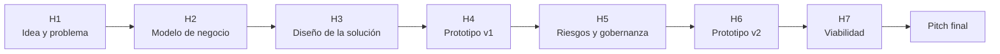

# Clase 26 · Cierre del Curso y Retroalimentación Final

📅 Miércoles 18 de noviembre de 2026
⏱️ 90 minutos
Cierre · Presentación Final del Proyecto
Sesión formativa · sin entrega

!!! info "Última clase del semestre"
    No hay entrega. La sesión cierra el proyecto con retroalimentación general de las
    presentaciones, revisa el recorrido del semestre y recoge la evaluación del curso por parte de
    ustedes. Las notas se publican en la página de [Notas](../notas.md).

## 🎯 Objetivos de la sesión

- Recibir retroalimentación general sobre las presentaciones finales.
- Mirar el recorrido completo: de una idea en el Hito 1 a un veredicto de viabilidad en el Hito 7.
- Identificar qué se llevan para aplicar IA en su trabajo comercial.
- Evaluar el curso: qué mantener y qué cambiar para la próxima versión.

---

## 🗓️ Agenda (90 min)

| Tiempo | Bloque |
|---|---|
| 0:00 – 0:20 | Retroalimentación general de las presentaciones finales |
| 0:20 – 0:45 | El recorrido del semestre: qué cambió en cada proyecto entre el Hito 1 y el 7 |
| 0:45 – 1:10 | Lo que se llevan: cómo seguir aplicando IA en el trabajo comercial |
| 1:10 – 1:25 | Evaluación del curso: qué mantener, qué cambiar |
| 1:25 – 1:30 | Cierre |

---

## 📖 Contenidos

### 1. El recorrido del semestre

Una pregunta para cada grupo, en dos minutos: **¿qué cambió de su idea original, y en qué hito
cambió?** Casi todos los proyectos sólidos tuvieron un momento en que algo que creían se cayó: en
"Derriba la idea", en la auditoría de sesgo, en la prueba de regresión o en el punto de quiebre.

### 2. Lo que se llevan

Las habilidades del curso no dependen de la herramienta de moda:

| Habilidad | Dónde la practicaron |
|---|---|
| Distinguir cuándo un problema es de ML predictivo, de IA generativa o de ninguno | Hitos 1 y 3 |
| Prototipar sin programar y demostrar que funciona con casos fijos | Hitos 4 y 6 |
| Detectar sesgo y riesgo de privacidad antes de que lo detecte otro | Hito 5 |
| Ponerle números a una iniciativa y decir qué supuesto la decide | Hito 7 |
| Convencer a un comité con evidencia, en diez minutos | Presentación final |

> 💡 Las herramientas que usaron este semestre van a cambiar. La pregunta **"¿cómo sé que esto
> funciona, a quién afecta y si se paga?"** no va a cambiar.

### 3. Evaluación del curso

Cada grupo responde, en una línea por pregunta:

1. ¿Qué parte del curso les sirvió más para el proyecto?
2. ¿Qué parte cambiarían o sacarían?
3. ¿La modalidad de **entrega en clases** les ayudó o les jugó en contra?
4. ¿Qué tema les faltó?

Sus respuestas se usan para preparar la próxima versión del curso.

---

🏁 **Fin del semestre.** Gracias por el trabajo de estos meses.
