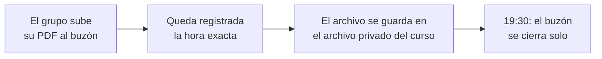

Entregas en clases
<h1>📬 Buzones de entrega</h1>

Cada avance del proyecto tiene su propio buzón. Se abre en el horario de clases, se cierra
automáticamente a las <strong>19:30</strong> del mismo día, y lo recibido queda archivado en el
archivo privado del curso. Los dos buzones de la <strong>entrega final</strong> están abiertos del 3 al
8 de noviembre.

!!! danger "Las tres reglas del buzón"
    1. **Un PDF por grupo**, con el **nombre del grupo** escrito igual que en la planilla del curso.
    2. **Solo se evalúa lo enviado hasta las 19:00.** El buzón acepta hasta las 19:30 como margen de
       cierre, pero lo que llegue después de las 19:00 queda registrado como fuera de plazo.
    3. **A las 19:30 el buzón se cierra solo.** No hay forma de entregar después, salvo
       justificación presentada por los canales formales de la Universidad.

## Cómo funciona

Cada envío queda guardado en un archivo **privado** del curso, al que solo accede el profesor, junto a un registro con la hora de recepción. Si un grupo reenvía, se guarda la última versión y el registro conserva ambos envíos.

## Buzón de cada avance

### 🚀 Hito 6A · 4%
**Miércoles 7 de octubre** · Primera mitigación implementada

*Backlog priorizado + cambio implementado con antes y después*

[📬 Abrir buzón](https://script.google.com/macros/s/AKfycbz7ZR7YRvRjDcpEgcjCeIcI8qzfBShLpPoxmYisZS4t8GeEDbEvAp9lg1sIrZKBiLyQ7A/exec?a=hito6a){.usm-btn target="_blank" rel="noopener"}

### 🚫 Hito 6B · sin entrega
**Miércoles 14 de octubre** · 🚫 No hubo clases

*Se integra al Hito 6C, que pasa a valer 6%. Este buzón no se usa.*

### 🚀 Hito 6C · 6%
**Lunes 19 de octubre** · Comparación v1 vs. v2 y prototipo v2 cerrado

*Banco de casos + tabla v1 vs. v2 + configuración final + documentación del cambio*

[📬 Abrir buzón](https://script.google.com/macros/s/AKfycbz7ZR7YRvRjDcpEgcjCeIcI8qzfBShLpPoxmYisZS4t8GeEDbEvAp9lg1sIrZKBiLyQ7A/exec?a=hito6c){.usm-btn target="_blank" rel="noopener"}

### 🚀 Hito 7A · 2,5%
**Miércoles 21 de octubre** · Impacto social

*Beneficios y costos sociales de la iniciativa*

[📬 Abrir buzón](https://script.google.com/macros/s/AKfycbz7ZR7YRvRjDcpEgcjCeIcI8qzfBShLpPoxmYisZS4t8GeEDbEvAp9lg1sIrZKBiLyQ7A/exec?a=hito7a){.usm-btn target="_blank" rel="noopener"}

### 🚀 Hito 7B · 2,5%
**Lunes 26 de octubre** · Evaluación privada

*Quién gana, quién paga, a cuántos alcanza*

[📬 Abrir buzón](https://script.google.com/macros/s/AKfycbz7ZR7YRvRjDcpEgcjCeIcI8qzfBShLpPoxmYisZS4t8GeEDbEvAp9lg1sIrZKBiLyQ7A/exec?a=hito7b){.usm-btn target="_blank" rel="noopener"}

### 🚀 Hito 7C · 2,5%
**Miércoles 28 de octubre** · Costos de operar

*Estructura de costos con supuestos explícitos*

[📬 Abrir buzón](https://script.google.com/macros/s/AKfycbz7ZR7YRvRjDcpEgcjCeIcI8qzfBShLpPoxmYisZS4t8GeEDbEvAp9lg1sIrZKBiLyQ7A/exec?a=hito7c){.usm-btn target="_blank" rel="noopener"}

### 🚀 Hito 7D · 2,5%
**Lunes 2 de noviembre** · Beneficio y conclusión

*Beneficio esperado y veredicto de viabilidad*

[📬 Abrir buzón](https://script.google.com/macros/s/AKfycbz7ZR7YRvRjDcpEgcjCeIcI8qzfBShLpPoxmYisZS4t8GeEDbEvAp9lg1sIrZKBiLyQ7A/exec?a=hito7d){.usm-btn target="_blank" rel="noopener"}

### 🎤 Final · Presentación en PDF
**Martes 3 al domingo 8 de noviembre, hasta las 23:59** · Las láminas del pitch

*Se presenta con este archivo. Máximo 25 MB.*

[📬 Abrir buzón](https://script.google.com/macros/s/AKfycbz7ZR7YRvRjDcpEgcjCeIcI8qzfBShLpPoxmYisZS4t8GeEDbEvAp9lg1sIrZKBiLyQ7A/exec?a=final-presentacion){.usm-btn target="_blank" rel="noopener"}

### 🎤 Final · Prototipo explicado
**Martes 3 al domingo 8 de noviembre, hasta las 23:59** · Con resumen ejecutivo

*Se evalúa con la lista de requisitos del prototipo final (10%). Máximo 25 MB.*

[📬 Abrir buzón](https://script.google.com/macros/s/AKfycbz7ZR7YRvRjDcpEgcjCeIcI8qzfBShLpPoxmYisZS4t8GeEDbEvAp9lg1sIrZKBiLyQ7A/exec?a=final-prototipo){.usm-btn target="_blank" rel="noopener"}

### 🗳️ Evaluación de pares
**Lunes 9 y lunes 16 de noviembre, de 17:00 a 20:00** · Durante las presentaciones

*Cada grupo evalúa a los que presentan (10%). En «Código del día», **ICS64225**.*

[🗳️ Abrir formulario](https://script.google.com/macros/s/AKfycbz7ZR7YRvRjDcpEgcjCeIcI8qzfBShLpPoxmYisZS4t8GeEDbEvAp9lg1sIrZKBiLyQ7A/exec?pares){.usm-btn target="_blank" rel="noopener"}

!!! warning "Entregas anteriores"
    Los avances del **Hito 5** (28 y 30 de septiembre) se recibieron por correo, antes de habilitar
    el buzón. Desde el Hito 6 en adelante, la entrega es por este medio.

!!! info "La entrega final es distinta"
    Los buzones de la **presentación en PDF** y del **prototipo explicado** no se abren en una
    clase: aceptan envíos desde el **martes 3** hasta el **domingo 8 de noviembre a las 23:59**,
    para todos los grupos. A esa hora se cierran solos. Ver la
    [guía de preparación](clases/preparacion-final.md).

## Preguntas frecuentes

??? question "¿Qué pasa si el PDF está incompleto?"
    Envíenlo igual. Un avance parcial entregado dentro del horario se evalúa; uno completo enviado
    después, no.

??? question "¿Puedo reenviar si me equivoqué de archivo?"
    Sí, mientras el buzón siga abierto. Se conserva la última versión recibida y el registro deja
    constancia de ambos envíos.

??? question "¿Qué pasa si no pude asistir a la clase?"
    El avance de esa sesión se pierde, salvo justificación presentada por los canales formales de la
    Universidad. Avisa a **sebastian.azocarm@usm.cl** apenas tengas el respaldo.

??? question "¿Dónde queda mi entrega?"
    En el archivo privado del curso, en la carpeta del avance correspondiente. Al enviar, el buzón
    muestra la hora de recepción: guarden esa pantalla como comprobante.