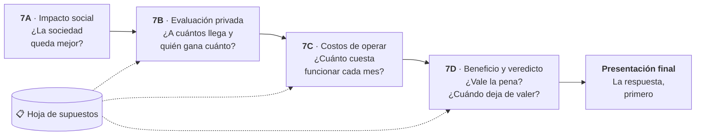

Recta final del curso
<h1>🧭 Lo que queda</h1>

Todo lo que falta responde a una sola pregunta: <strong>¿vale la pena implementar su proyecto, y
bajo qué condiciones deja de valer?</strong> Cada avance agrega una pieza a esa respuesta, y la
presentación final la cuenta en ocho minutos.

## 🧵 El hilo conductor

Hasta el Hito 6 construyeron **la solución**. Desde el Hito 7 evalúan **si conviene hacerla**. Los
avances no son tareas sueltas: cada uno usa los números del anterior, y todos se anotan en un mismo
documento, la **hoja de supuestos**.

| Avance | La pregunta | Qué agrega a la hoja de supuestos | Qué usa de antes |
|---|---|---|---|
| **7A** · Impacto social | ¿La sociedad queda mejor con el proyecto? | Quiénes ganan y pierden, y las transferencias excluidas | Los riesgos del Hito 5 |
| **7B** · Evaluación privada | ¿A cuántos llega y quién captura el valor? | El **embudo de alcance** y el **valor incremental** al mes | Lo que en el 7A fue transferencia puede ser valor privado aquí |
| **7C** · Costos de operar | ¿Cuánto cuesta operarlo cada mes? | Inversión, costos fijos y variables, y el **costo por transacción** | El volumen del embudo del 7B y las mitigaciones del Hito 5 |
| **7D** · Beneficio y veredicto | ¿Vale la pena? ¿Cuándo deja de valer? | El flujo, el VAN, la sensibilidad y el **punto de quiebre** | Las cifras del 7B y el 7C, sin cambiarlas en silencio |
| **Presentación final** | ¿Por qué el comité debería aprobarlo? | Nada nuevo: la cuentan | El veredicto del 7D es la lámina más importante |

---

## 🔢 Un ejemplo de punta a punta

Sigamos con el ejemplo de clases: un modelo que le dice al equipo de cobranza **a qué clientes en
mora llamar primero**. Las cifras son ilustrativas; lo que importa es cómo pasan de un avance al
siguiente.

=== "7A · Impacto social"

    Los ejecutivos dejan de hacer llamadas inútiles y los clientes son contactados a tiempo. El costo
    social: clientes de comunas que el modelo podría priorizar menos (el sesgo del Hito 5A). La deuda
    que la empresa recupera **no** es beneficio social: es una **transferencia** del cliente a la
    empresa.

=== "7B · Evaluación privada"

    **Embudo:** 12.000 clientes en mora al mes → 9.000 con teléfono válido (75%) → el modelo prioriza
    el 30%: **2.700 llamadas** → se logra contactar al 60%: **1.620 clientes**.

    **Sin proyecto**, paga el 30% de los contactados; **con proyecto**, el 35%. La diferencia
    (**5 puntos**) son 81 clientes más que pagan al mes, con una deuda promedio de $150.000:
    **$12,15 millones al mes de valor incremental**.

    👉 Lo que en el 7A era transferencia aquí sí cuenta: es valor que **captura la empresa**.

=== "7C · Costos de operar"

    **Inversión inicial:** $8 millones (integración y preparación de datos).

    **Operación mensual:** cómputo y licencias $300.000 (variable) + supervisión humana 10 h × $15.000
    = $150.000 (fijo) + auditoría de sesgo trimestral, la mitigación del 5A, $600.000 / 3 =
    $200.000 al mes (fijo). Total: **$650.000 al mes**.

    **Costo por transacción:** $650.000 / 2.700 llamadas priorizadas (el volumen del 7B) = **$241
    por llamada**.

=== "7D · Beneficio y veredicto"

    **Beneficio neto:** $12,15 millones − $0,65 millones = **$11,5 millones al mes**, y la inversión
    se recupera en menos de un mes.

    **Punto de quiebre:** cada punto de mejora en la tasa de pago vale $2,43 millones al mes. Los
    costos mensuales más la inversión repartida en 24 meses suman $0,98 millones, así que el proyecto
    deja de convenir si la mejora cae **bajo 0,4 puntos** (hoy suponemos 5).

    **Veredicto:** viable, **siempre que** la mejora real en el piloto supere 0,4 puntos y la
    auditoría de sesgo no detecte trato desigual por comuna.

=== "Presentación final"

    La primera lámina dice el veredicto: *"Priorizar la cobranza con IA recupera $11,5 millones al
    mes; deja de convenir solo si la mejora en la tasa de pago cae bajo 0,4 puntos."* Todo lo demás
    es la evidencia que lo sostiene.

---

## 📅 Calendario de lo que queda

| Cuándo | Modalidad | Qué hacen | Qué entregan | Peso |
|---|---|---|---|---:|
| **Hoy, miércoles 28 de octubre** · 17:30–19:00 | 🏫 Presencial | Embudo y valor (7B) y costos de operar (7C) | **Un PDF con el 7B y el 7C**, en el buzón con clave | 2,5% + 2,5% |
| **Lunes 2 de noviembre** · 17:30–19:00 | 🏫 Presencial | Flujo, VAN, sensibilidad y veredicto | **Hito 7D**, en su buzón ([Clase 21](clases/clase21.md)) | 2,5% |
| **Martes 3 al domingo 8 de noviembre** | 🚫 Sin clases | Preparar el pitch y el prototipo final ([guía](clases/preparacion-final.md)) | **Presentación en PDF** y **prototipo explicado**, hasta el **domingo 8, 23:59** | 10% (prototipo) |
| **Lunes 9 de noviembre** · 17:00–20:00 | 🏫 Presencial | Presentan 6 grupos y todos evalúan ([Clase 22](clases/clase22.md)) | Pitch en vivo y evaluación de pares | 10% (pares) + 10% (profesor) |
| **Lunes 16 de noviembre** · 17:00–20:00 | 🏫 Presencial | Presentan 5 grupos y cierre del curso ([Clase 23](clases/clase23.md)) | Pitch en vivo y evaluación de pares | |

Lo que queda vale el **37,5% de la nota final**: 7,5% de los avances 7B, 7C y 7D y 30% de la
presentación final.

---

## 📤 Hoy: un solo PDF con el 7B y el 7C

El lunes 26 no hubo clase presencial, así que hoy se entregan los dos avances juntos. Material de
cada uno: [Clase 19 · Evaluación privada](clases/clase19.md) y
[Clase 20 · Costos de operar](clases/clase20.md).

**Estructura sugerida del PDF** (cada parte se corrige con su propia pauta):

1. **Parte 1 · Hito 7B — Evaluación privada** (máximo 2 páginas)
    - [ ] Embudo de alcance con un número y un supuesto en cada paso.
    - [ ] Situación sin proyecto, en dos o tres líneas.
    - [ ] Tabla de captura de valor: mecanismo, quién lo captura y cuánto al mes, calculado como
          **incremental** sobre la situación sin proyecto.
    - [ ] Coherencia con el 7A: lo que allí excluyeron como transferencia puede aparecer aquí.
2. **Parte 2 · Hito 7C — Costos de operar** (máximo 2 páginas)
    - [ ] Tabla de inversión inicial y tabla de operación mensual, cada ítem con supuesto y fuente.
    - [ ] Cada costo de operación marcado como fijo o variable.
    - [ ] Al menos una **mitigación del Hito 5** y la **supervisión humana** costeadas.
    - [ ] Costo por transacción, calculado con el volumen del embudo de la Parte 1.
    - [ ] Rango mínimo – probable – máximo para el costo más incierto.
3. **Anexo · Hoja de supuestos** (una sola, numerada S1, S2, S3…)
    - [ ] Al menos cinco supuestos del 7B y los del 7C, cada uno con su fuente o razón.
    - [ ] El **supuesto crítico** marcado: el que más cambiaría el resultado si estuviera equivocado.

<strong>📬 Buzón único de los Hitos 7B y 7C · hoy, de 17:30 a 19:00</strong>
Un <strong>PDF por grupo</strong> con ambas partes, el nombre del grupo igual que en la planilla y la <strong>clave del día</strong>, que se da en la sala. El buzón se cierra a las 19:30, pero solo se evalúa lo enviado <strong>hasta las 19:00</strong>.

[🔑 Abrir buzón 7B + 7C](https://script.google.com/macros/s/AKfycbz7ZR7YRvRjDcpEgcjCeIcI8qzfBShLpPoxmYisZS4t8GeEDbEvAp9lg1sIrZKBiLyQ7A/exec?a=hito7c){.usm-btn target="_blank" rel="noopener"}

!!! tip "Si ya subieron el 7B el lunes"
    Súbanlo de nuevo hoy dentro del PDF único. Se corrige la versión de hoy.

---

## 🎤 Cómo llega todo esto a la presentación final

| Lámina del pitch | Sale de |
|---|---|
| El problema y la solución | Hitos 1 a 4 |
| Por qué es confiable | Hitos 5 y 6: riesgos, mitigaciones y prototipo v2 |
| Quién gana y quién pierde | **7A** |
| A cuántos llega y cuánto vale | **7B** |
| Cuánto cuesta | **7C** |
| **Vale la pena, y hasta dónde** | **7D**, la lámina que decide |

Por eso la **trazabilidad** pesa en la pauta del Hito 7: si una cifra cambia entre avances, digan
cuál cambió y por qué. Una cifra que cambia en silencio es lo primero que va a preguntar el comité.
